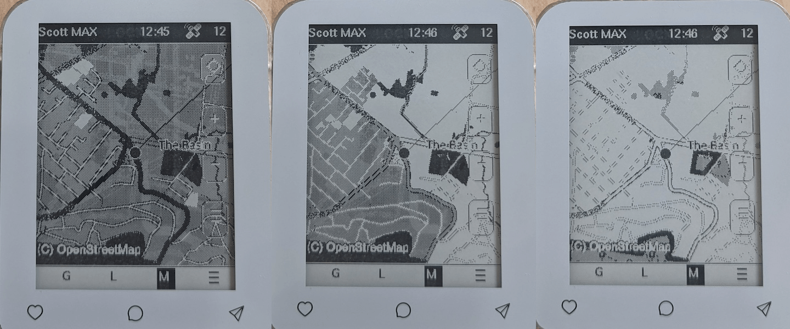
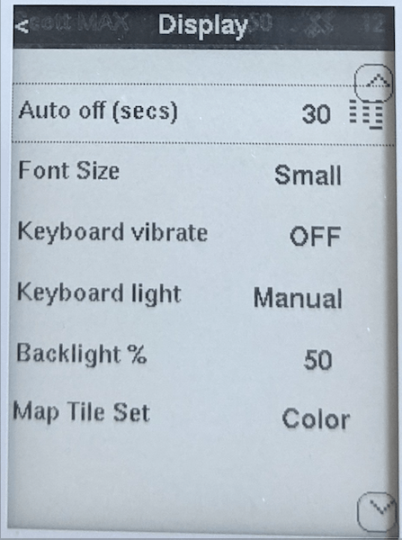
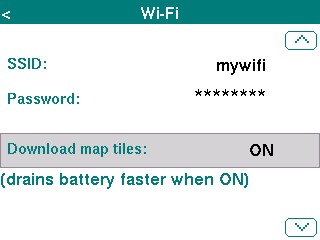
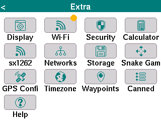

The latest release of the Ripple UI firmwares has a number of fixes and improvements:
* epaper devices (Pro/Max/T5) now support dithering of colour map tilesets
* some crash bugs now fixed
* Map tile downloads over WiFi
* New devices (MeshPager X2, WIO Tracker L2 Pro)
* GPS compass arrow
* Some multi-byte path fixes (eg. adverts)
* Ripple Network: End of life

## ePaper Maps

The T-Deck Max/Pro and the T5 Pro firmwares now support switching map tile sets, between
dedicated black & white (whatever is in the ```/tiles-bw``` fodler) and standard
colour OSM tiles (in the ```/tiles``` folder)

The colour tiles are now dithered and work surprisingly well. The translation of the colours
is not always ideal, so you can manually adjust a contrast threshold value used by
the algorithm, by pressing ALT+1..9. Below is the same map view, but with contast: ALT+5, ALT+4, ALT+3



The new **Display** preferences screen has the option for switching the map tile set:



## Crash Fixes

There were three separate bugs found, related to multi-byte paths, and rxlog (Diagnostics screen).
The crashes were only very intermittent, but so far the v12.3 seems to be super solid. 

## Map Tile Download

There is now a dedicated **WiFi** config screen (from home Extra menu): 



Then press ENTER to save changes. You will then be prompted to reboot the device to apply the changes.
This is a little cumbersome, but it really pays off in terms of battery drain if the WiFi is off from the boot state.

After enabling the WiFi downloads, you should see the orange dot from the menu which
indicates the connection is successful:



**NOTE:** For the epaper devices, the map tile download is only for the ```color``` tile set option!

With the tile download enabled, the map tiles are downloaded (and saved to SD card) _on demand_ as you zoom/pan. Note, there
is no bulk tile downloading supported at this time.

## New devices

Two new devices are now supported:
* Seeed MeshPager X2
* Seeed WIO Tracker L2 Pro

## GPS Compass

When the device is moving, there is now a blue direction arrow rendered. For the new devices (X2, L2, and M9)
which have a digital compass, the arrow is rendered even when device is not moving,
and updates as you rotate the device (device must be horizontal).

The digital compass also requires calibration, and there is a new home Extra menu: **Calibrate Compass**

## Ripple Network Type

Ver 12.3 marks the beginning of deprecating the Ripple network profile type. 
It has long since been eclipsed by the MeshCore network, and this version now
does _not_ allow creating Ripple network profiles. In future releases, the profile type
support will be removed completely, but for now it will still load existing Ripple profiles.

## Download

The new firmwares are all available via the [MeshCore Flasher](https://flasher.meshcore.io).


