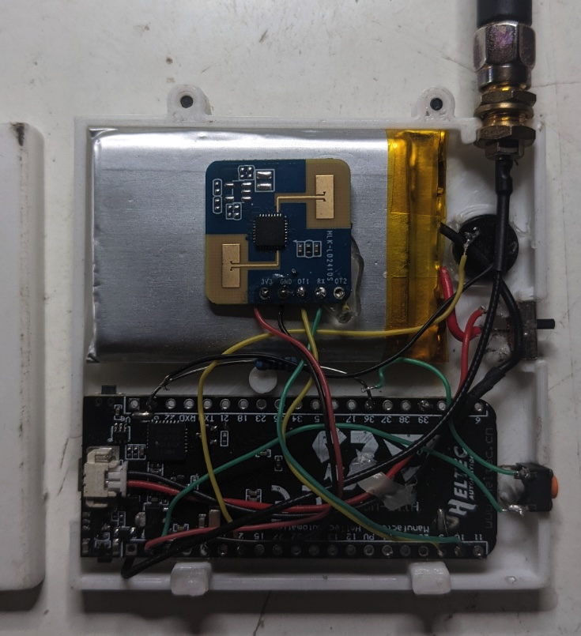
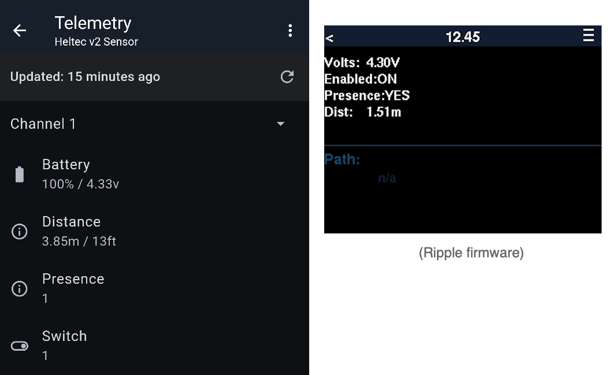
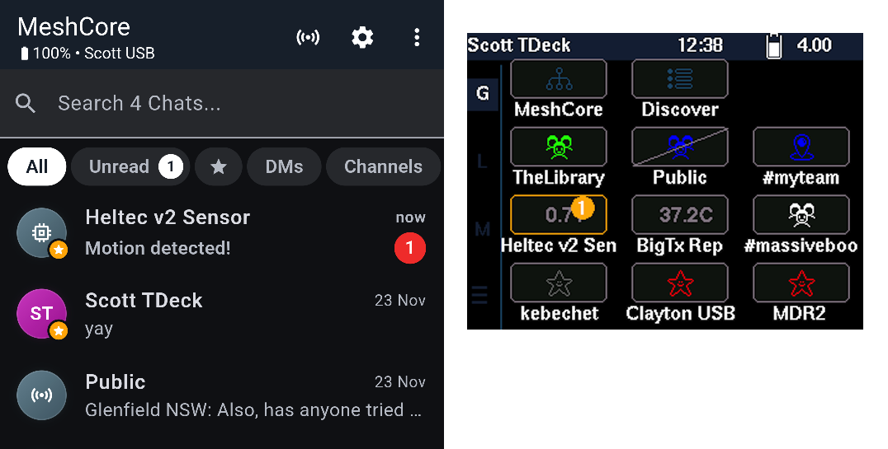

I recently did some experiments with 24GHz human presence sensors and MeshCore. You can buy these sensors cheaply from AliExpress (just search for 'LD2410S').

## The Wiring

I am using the (now old) Heltec StickLite for these experiments as I have _heaps_ lying around, and they're more than adequate for the job, but you could use any board for this. (the code is easily adaptable to any of the boards supported by the MeshCore project, which is over 100 at present).



This is an old pager project from the Ripple days, so ignore the wiring for the buzzer and the push button (these are not needed for this experiment). You only need 4 wires from the LD2410S to the main board:

Sensor   ->   Main board

* 3V3  ->  any of the 3.3V power pins (see red wire)
* GND  ->  any of the GND pins (see black wire)
* OT1  ->  Serial RX (see yellow wire)
* RX  ->  Serial TX  (see green wire)

You can optionally wire the OT2 pin of the sensor to a digital input pin on the main board, and this can be used as a 'wake up' interrupt, if you want to try a firmware that sleeps to save power.

## The Code

For sensors, you have to get _down and dirty_ with the dev tools. There are way too many different sensors and behaviours/features to cater for in one generic, all-purpose firmware, so you have to program the specifics yourself.

To make life easier, I wrote a 'simple_sensor' sketch for the MeshCore project many months ago, to serve as a template for such firmwares. To make your life even easier, I have published a fork of the MeshCore repo with this specific motion sensor all done for you. (how amazingly generous of me!)

Just clone this repo: [https://github.com/ripplebiz/MeshCore-sensor-playground](https://github.com/ripplebiz/MeshCore-sensor-playground)

Checkout the **'dev'** branch, then open it up in Visual Studio Code with the PlatformIO extension installed.

The specific target environment is: ```Heltec_StickLite_Sensor```

If you want to see the specific diffs/commits for this motion sensor code, just see this comparison: [https://github.com/meshcore-dev/MeshCore/compare/dev...ripplebiz:MeshCore-sensor-playground:dev](https://github.com/meshcore-dev/MeshCore/compare/dev...ripplebiz:MeshCore-sensor-playground:dev)

So, this variant creates a custom ```MotionSensorManager``` class, which encapsulates all of the management of the LD2410S sensor. The ```querySensors()``` method shows that 3 telemetry values are collected:

```cpp
bool MotionSensorManager::querySensors(uint8_t requester_permissions, CayenneLPP& telemetry) {
  telemetry.addSwitch(TELEM_CHANNEL_SELF, _armed ? 1 : 0);
  telemetry.addPresence(TELEM_CHANNEL_SELF, ld2410s.isMotionDetected() ? 1 : 0);
  telemetry.addDistance(TELEM_CHANNEL_SELF, ((float)ld2410s.getDistance()) / 100.0f );  // convert to meters
  return true;
}
```

So, when you query the telemetry from this node, there will be these plus the board's battery voltage:



## Alerts!

The example firmware also creates alerts when the sensor is 'armed' and the ```isMotionDetected()``` is true. This is in the **/examples/simple_sensor/main.cpp** module:

```cpp
Trigger presence_alert, critical_batt;
TimeSeriesData  battery_data;

void onSensorDataRead() override {
  float batt_voltage = getVoltage(TELEM_CHANNEL_SELF);

  battery_data.recordData(getRTCClock(), batt_voltage);   // record battery
  alertIf(batt_voltage < 3.4f, critical_batt, HIGH_PRI_ALERT, "Battery is critical!");
  alertIf(sensors.isArmed() && sensors.isMotionDetected(), presence_alert, LOW_PRI_ALERT, "Motion detected!");
}
```

The alerts are managed by the underlying ```SensorMesh``` class, and it handles dispatching a MeshCore text DM message to all users who are in the ACL, and are registered for alerts (if you login with the admin password, you get this ACL permission automatically).

So, you will see the unread message counter (and alert sound, if configured):



As an extra touch, the Ripple firmware renders the Home grid cell with an orange border when the sensor is in the 'armed' state, so you can quickly see whether your sensors are currently armed. It also renders the last telemetry value in the cell (in this case, the distance value).

## Arming and Disarming

The example firmware supports some additional CLI commands, namely ```arm``` and ```disarm```. This is handled by the code in the main.cpp module here:

```cpp
bool handleCustomCommand(uint32_t sender_timestamp, char* command, char* reply) override {
  if (strcmp(command, "disarm") == 0) {    // example 'custom' command handling
    sensors.setArmed(false);
    strcpy(reply, "OK - now disarmed");
    return true;   // handled
  }
  if (strcmp(command, "arm") == 0) {    // example 'custom' command handling
    sensors.setArmed(true);
    strcpy(reply, "OK - now armed");
    return true;   // handled
  }
  return false;  // not handled
}
```

## Conclusion

This is quite a handy node type to have. I plan to put a bunch of these around my house, inside of weatherproof housings, with solar panels, so that I can get intruder alerts. There are many more customisations you can make, and with the open code, you can change it however you like.
